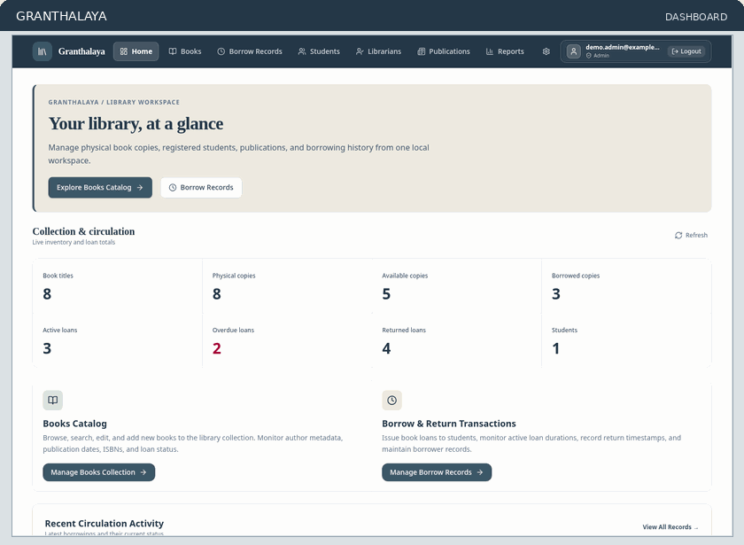
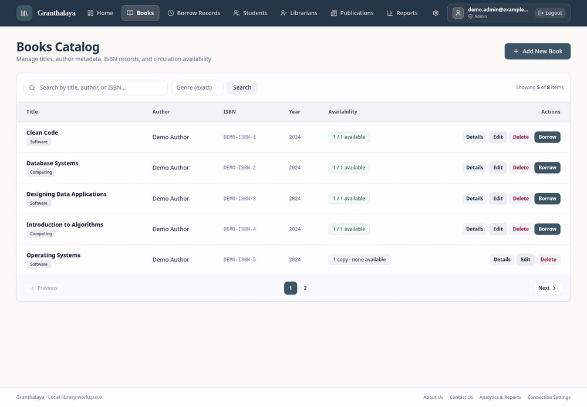
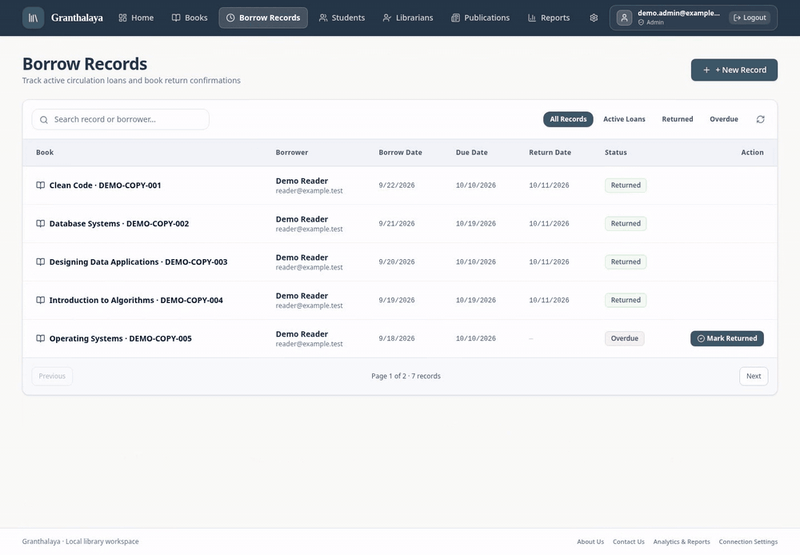

<p align="center">
  
</p>

<p align="center">
  <strong>A local workspace for managing physical books, registered borrowers, and the complete lending lifecycle.</strong>
</p>

Granthalaya is a **local-only, full-stack library management system** built with React, ASP.NET Core, and SQL Server. It separates book titles from individual physical copies, connects each loan to a registered student, and keeps borrowing history intact after returns. Staff manage the catalog, circulation, publications, and operational reports through an interface with Admin/Librarian permissions.

The application runs on your own machine. There is **no hosted demo, cloud database, or paid API requirement**.

---

## Application Preview & Screenshots

<p align="center">
  
</p>

| Dashboard & Inventory | Books & Physical Copies |
| :---: | :---: |
|  |  |
| **Circulation & Borrowing** | **Library Reports** |
|  |  |
| **Student Directory** | **Staff Account Management** |
|  |  |

*Captured from the running React frontend and SQL Server-backed API using disposable demonstration records. The preview montage above uses these genuine screenshots; it is not a simulated workflow. The workflow GIFs below record actual browser interactions with the API and a disposable SQL Server database; see the [capture guide](docs/GIF_CAPTURE_GUIDE.md).*

---

## Key Features

### Book Inventory

Search the catalog by title, author, ISBN, or genre. Track physical copies with unique accession numbers, conditions, and circulation statuses.

<p align="center">
  
</p>

### Borrowing & Returns

Issue an available copy to a registered student, choose a valid due date, and preserve the loan after return. The recording shows the active loan, availability change, confirmed return, and retained history.

<p align="center">
  
</p>

- **Student Directory** — Register, search, and edit borrowers using unique registration numbers; protect borrowing history from accidental deletion.
- **Database-Enforced Circulation Rules** — A filtered SQL Server unique index prevents simultaneous active loans for the same physical copy, including under concurrent requests.
- **Admin & Librarian Access** — ASP.NET Core Identity protects staff endpoints, with explicit initial Admin setup, role checks, account controls, and token revocation.
- **Operational Analytics** — View persisted title, copy, circulation, overdue, and genre statistics without placeholder values.
- **Publications & Inquiries** — Manage newspaper/magazine records and local contact submissions; Admins can review and search the inquiry inbox.
- **Search & Pagination** — Server-side catalog filtering, borrowing-history pagination, and Admin inquiry pagination.

---

## Tech Stack

| Layer | Technology |
| --- | --- |
| **Frontend** | [React 19](https://react.dev/), TypeScript, [Vite](https://vite.dev/), [Tailwind CSS](https://tailwindcss.com/) |
| **Backend** | [ASP.NET Core 10](https://dotnet.microsoft.com/apps/aspnet), C#, REST APIs, application services |
| **Database** | [SQL Server 2022 Developer](https://www.microsoft.com/en-us/sql-server/sql-server-downloads), [EF Core 10](https://learn.microsoft.com/en-us/ef/core/) |
| **Authentication** | ASP.NET Core Identity, opaque bearer tokens, Admin/Librarian authorization |
| **Local Infrastructure** | [Podman](https://podman.io/) + Compose, persistent SQL Server volume |
| **Testing** | xUnit, SQL Server integration tests, [Playwright](https://playwright.dev/) browser journeys |

---

## Architecture Summary

```text
React + TypeScript (localhost:3000)
             │
             │ JSON over HTTP + Identity bearer token
             ▼
       ASP.NET Core API (localhost:5199)
             │
             ├── Identity authentication + role policies
             │
             ▼
      Controllers → Application services
                          │
                          ▼
                     EF Core 10
                          │
                          ▼
               SQL Server 2022 Developer
                (local Podman volume)
```

Granthalaya follows a service-based backend structure. The browser presents database-backed results, while the backend enforces authorization, validation, borrowing rules, and referential integrity.

**Domain model:** `Book → BookCopy → BorrowRecord ← Student`. `Book` stores a title's metadata; `BookCopy` represents an actual physical item. Borrowing references the copy and student, with due/return dates and historical records. A SQL Server filtered unique index (`UX_BorrowRecords_ActiveCopy`, active when `ReturnDate IS NULL`) protects each copy against duplicate active loans.

For implementation details, see the [security review](docs/SECURITY.md), [verification report](docs/VERIFICATION.md), and [local setup guide](docs/LOCAL_SETUP.md).

---

## Quick Local Setup

### Prerequisites

- Linux x64, Git
- **.NET 10 SDK** and EF CLI (`dotnet tool restore`)
- **Node.js 22+** with npm
- **Podman** and a Compose provider (such as `podman-compose`)
- A supported Chromium browser for optional Playwright testing

### 1. Clone and install

```bash
git clone https://github.com/TheQuantumPanda/Granthalaya.git
cd Granthalaya

dotnet tool restore
dotnet restore Library-Management-System.Tests
npm --prefix LMS-Frontend ci
```

### 2. Start the local database

```bash
node dev/create-sql-env.mjs
podman compose --env-file dev/sqlserver.env -f dev/compose.yaml up -d
```

Wait until `granthalaya-sqlserver-dev` reports **healthy**. The generated `dev/sqlserver.env` is ignored by Git; do not commit or share it. The SQL Server port is bound to `127.0.0.1:14333`, and normal container restarts preserve the database volume.

### 3. Configure the API and create the first Admin

Use the [step-by-step Bash and Fish guide](docs/LOCAL_SETUP.md#3-configure-backend-user-secrets-and-apply-migrations) to store the database connection in **.NET user secrets**, apply migrations, and run the explicit `--bootstrap-admin` command. There are no default Admin credentials or public staff-registration endpoints.

### 4. Start the application

In two separate terminals from the repository root:

```bash
# Terminal 1 — API
dotnet run --project Library-Management-System
```

```bash
# Terminal 2 — React UI
npm --prefix LMS-Frontend run dev
```

Open **http://127.0.0.1:3000** and sign in with the Admin account you created. The API uses `http://localhost:5199` by default.

For private configuration, Fish equivalents, troubleshooting, safe shutdown, and test setup, see [Local Setup](docs/LOCAL_SETUP.md).

---

## Environment Configuration

| Setting | Location / purpose |
| --- | --- |
| `MSSQL_SA_PASSWORD` | Generated in ignored `dev/sqlserver.env`; used by local SQL Server Compose |
| `ConnectionStrings:DefaultConnection` | Store in .NET user secrets for the API; keep the connection string out of tracked files |
| `VITE_API_BASE_URL` | Public browser configuration in ignored `LMS-Frontend/.env.local`; defaults to `http://localhost:5199` |
| `BootstrapAdmin__Enabled`, `BootstrapAdmin__Email`, `BootstrapAdmin__Password` | Temporary environment values for the explicit first-Admin CLI; unset afterward |
| `GRANTHALAYA_TEST_SQL_CONNECTION` | Private environment value used by SQL tests and the disposable browser runner |

For the frontend's default local configuration:

```bash
cp LMS-Frontend/.env.example LMS-Frontend/.env.local
```

The UI accepts loopback API addresses. `VITE_*` values are visible to the browser and must never contain secrets. The E2E runner uses its own API/UI ports (**5209/3100**) and generated database; normal development uses **5199/3000**. See [Local Setup](docs/LOCAL_SETUP.md) for complete private configuration.

---

## Access & Roles

| Operation | Admin | Librarian |
| --- | :---: | :---: |
| Catalog, physical copies, students, circulation | ✓ | ✓ |
| Publications, dashboard, reports | ✓ | ✓ |
| Librarian directory and staff sign-in accounts | ✓ | — |
| Assign roles, disable/enable staff accounts | ✓ | — |
| Read contact inquiries | ✓ | — |

Students are **registered borrowers**, not application login accounts. Identity uses **opaque bearer tokens, not JWTs**. The frontend validates the session with the API and stores the access token for the current browser tab. See [Security & Trade-offs](docs/SECURITY.md) for limitations and revocation behavior.

---

## Testing

Granthalaya's documented regression baseline includes **39 passing backend tests (7 SQL Server-backed cases)** and **5 Playwright browser journeys** covering catalog management, circulation, permissions, validation, publications, and staff-account lifecycle. These were run against real SQL Server databases; browser tests create and remove their own disposable database.

```bash
# Backend tests; supply the private test connection as in LOCAL_SETUP.md
dotnet test Library-Management-System.Tests

# Frontend checks
npm --prefix LMS-Frontend run lint
npm --prefix LMS-Frontend run build

# End-to-end browser tests; requires the private test connection
npm --prefix LMS-Frontend run test:e2e
```

Without `GRANTHALAYA_TEST_SQL_CONNECTION`, the SQL-dependent backend tests **skip**. A skipped run is not equivalent to relational verification. See [Test Results](docs/VERIFICATION.md) for the observed evidence and [Local Setup](docs/LOCAL_SETUP.md#6-backend-sql-server-tests) for safe test configuration.

---

## Detailed Documentation

- [**Local Setup — Bash & Fish**](docs/LOCAL_SETUP.md) — from fresh checkout to running UI/API, migrations, and isolated tests
- [**Verification & Test Coverage**](docs/VERIFICATION.md) — what was tested, how, and outstanding limitations
- [**Security Review**](docs/SECURITY.md) — authentication, authorization, token storage, secrets, and trade-offs
- [**Demonstration Script**](DEMO.md) — a short walkthrough for recording a portfolio demo
- [**Workflow GIF Capture**](docs/GIF_CAPTURE_GUIDE.md) — real browser recordings, encoding, and verification
- [**UI Refresh**](docs/UI_REFRESH.md) — design direction and visual verification

---

## Known Limitations

- **Local only:** No hosted live demo; the application requires a local SQL Server instance.
- **No public borrower login:** Student accounts are library records, while application logins are staff-only.
- **Scope:** Reservations, renewals, late-fee payments, and automated emails are not implemented.
- **Search:** Catalog filtering uses SQL Server text matching, not a full-text search engine.
- **Browser coverage:** The recorded automated journeys use Chromium; other browser engines and screen readers were not fully tested.

---

## Project Status

Granthalaya is maintained as an **MIT-licensed, local-only portfolio project** demonstrating relational inventory modeling, protected staff workflows, SQL Server-backed circulation, and tested full-stack development.

[Repository](https://github.com/TheQuantumPanda/Granthalaya)

## MIT License

Released under the [MIT License](LICENSE). Copyright © 2026 TheQuantumPanda.
