<h1 align="center">
  📚 Library Management System
</h1>

<p align="center">
  A full-stack, enterprise-grade web application for managing library catalogs, circulation, student members, librarian staff, periodical publications, and real-time analytics — built with <strong>ASP.NET Core 10</strong> and <strong>React 19</strong>.
</p>

<p align="center">
  
  
  
  
  
  
  
</p>

---

## 📸 Screenshots

### 🏠 Dashboard & Home

| Hero Banner | System Metrics & Recent Activity |
|:-----------:|:--------------------------------:|
| 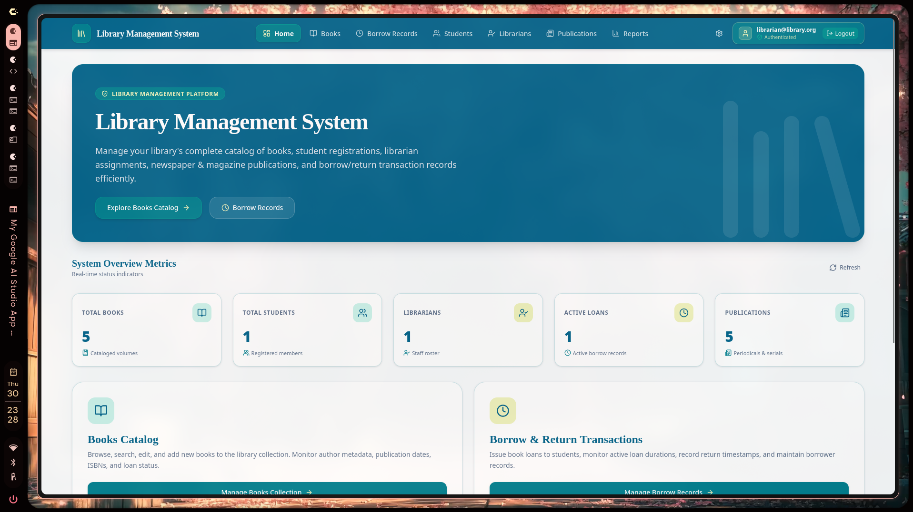 | 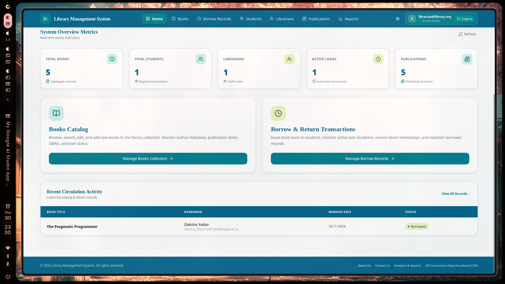 |

---

### 📖 Books Catalog

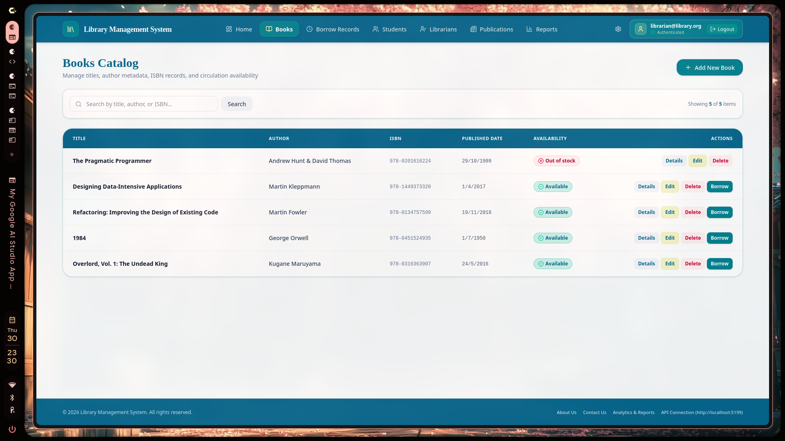

> Title metadata, physical-copy inventory, availability counts, and inline Borrow actions.

---

### 🔄 Borrow Records

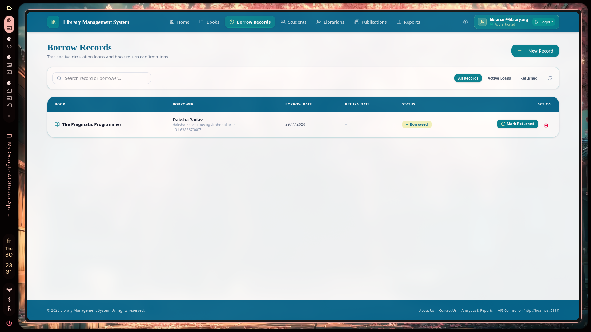

> Track current and historical student loans by physical copy, with due dates and one-click **Mark Returned** action.

---

### 👨‍🎓 Students Directory

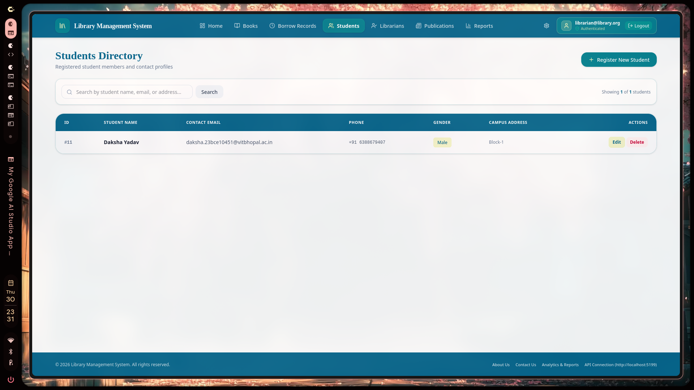

> Register and manage student borrower accounts including contact details, gender, and campus address.

---

### 👨‍💼 Librarians Staff Roster

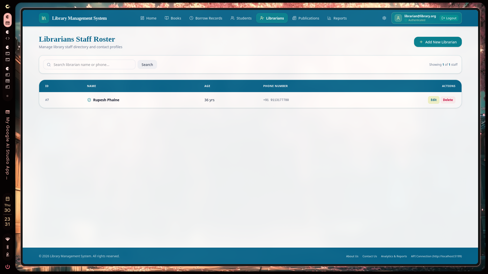

> Administer library staff with ID, name, age, and contact records.

---

### 📰 Publications Directory

| Newspapers | Magazines |
|:----------:|:---------:|
| 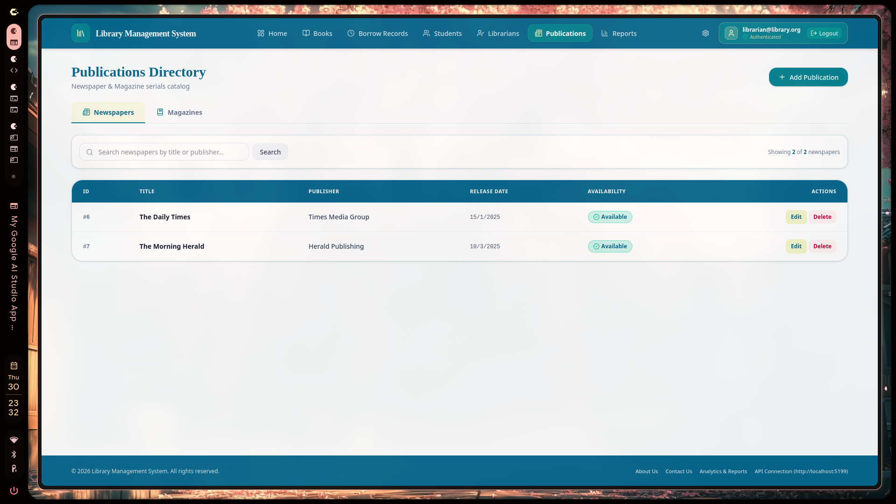 | 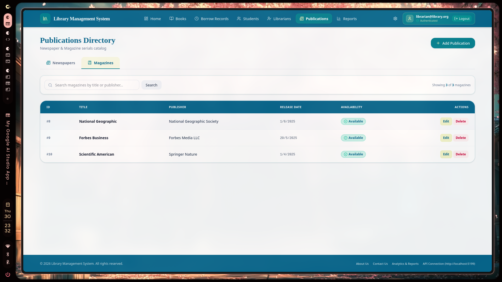 |

> Manage Newspapers and Magazines in a tabbed directory with publisher, release date, and availability status.

---

### 📊 Analytics & Reports

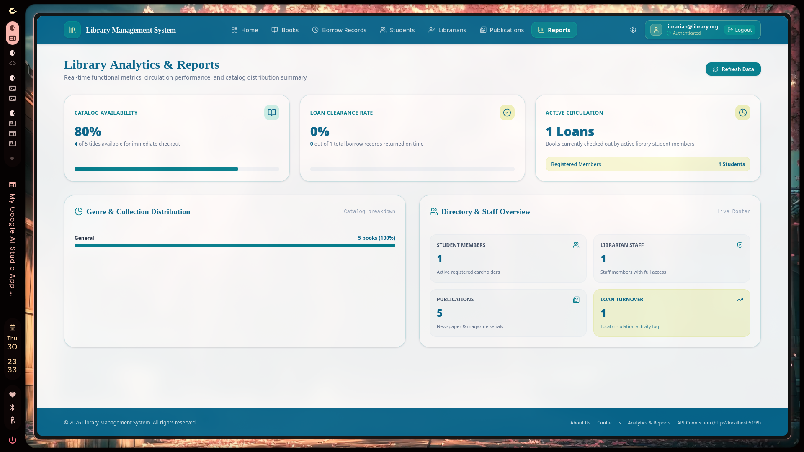

> Real-time metrics: Catalog Availability %, Loan Clearance Rate, Active Circulation, Genre & Collection distribution, and Staff overview.

---

### 🔐 Authentication

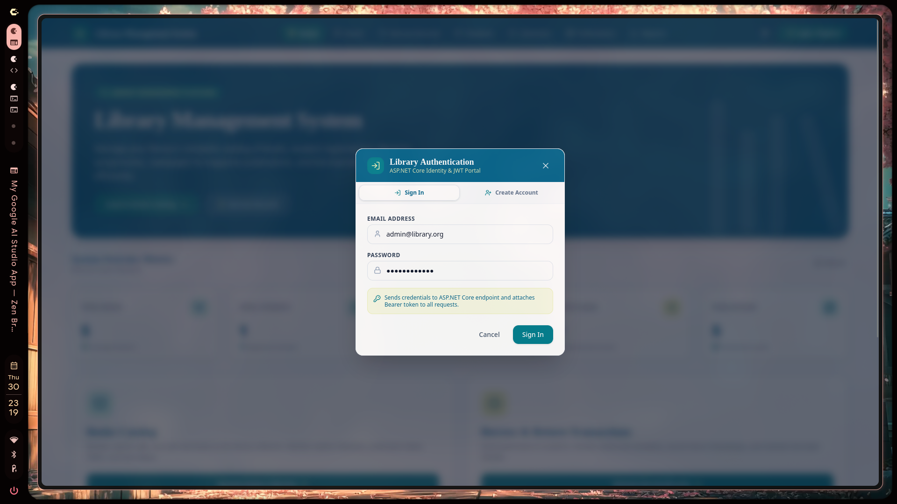

> ASP.NET Core Identity issues opaque bearer tokens for staff sign-in. Admin and Librarian permissions are enforced by the API.

---

### ℹ️ About & Contact

| About Us | Contact & Support Desk |
|:--------:|:----------------------:|
| 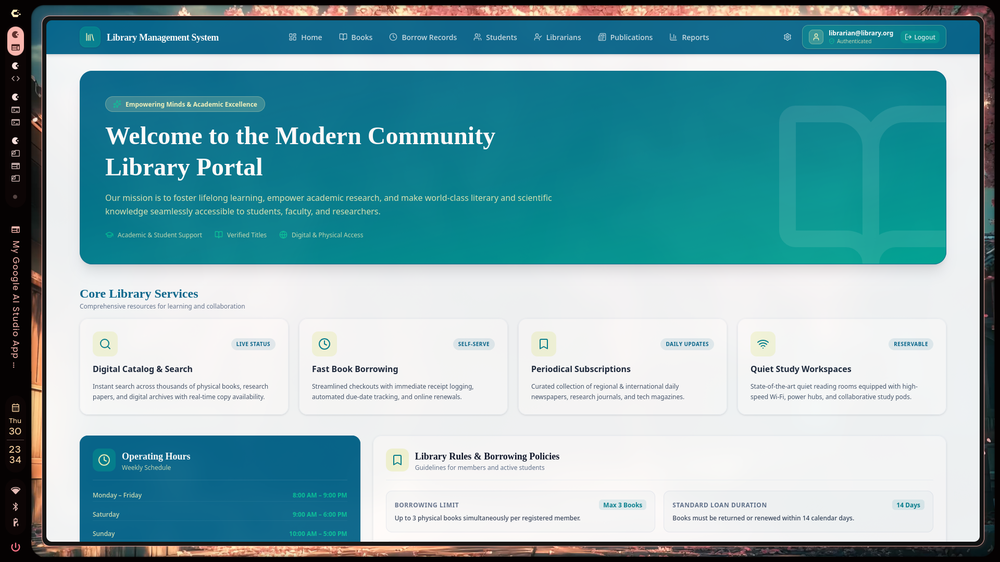 | 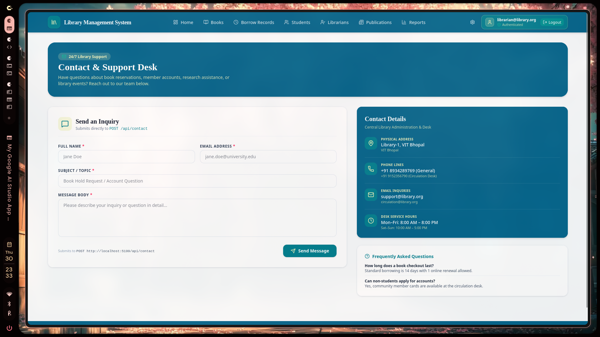 |

---

## ✨ Features

| Module | Capabilities |
|--------|-------------|
| **📚 Book Catalog** | Add, edit, delete, search titles; manage physical copies and availability counts. |
| **🔄 Circulation** | Issue specific copies to registered students, track due dates and loan history; availability is calculated from active loans. |
| **👨‍🎓 Students** | Register student members with contact & campus address profiles. |
| **👨‍💼 Librarians** | Manage staff directory with full CRUD. |
| **📰 Publications** | Catalog newspapers & magazines with publisher and availability data. |
| **📊 Analytics** | Real-time dashboard: availability %, loan clearance rate, genre distribution, staff overview. |
| **🔐 Authentication** | ASP.NET Core Identity opaque bearer tokens with Admin/Librarian server-side authorization and controlled staff provisioning. |
| **🤖 AI Assistant** | Gemini support is listed in the project dependencies; no assistant endpoint is present in this checkout. |
| **📬 Contact** | Support inquiry form that submits directly to `POST /api/contact`. |

---

## 🏗️ Architecture

```
┌───────────────────────────────────────────────────────┐
│                   React 19 SPA Frontend                │
│         TypeScript · Vite · TailwindCSS v4             │
│              Framer Motion · Lucide Icons              │
│            Running on http://localhost:3000             │
└────────────────────────┬──────────────────────────────┘
                         │  HTTP REST (Identity opaque bearer tokens)
                         ▼
┌───────────────────────────────────────────────────────┐
│              ASP.NET Core 10 Web API                   │
│    Controllers → Services (Interface) → EF Core        │
│         Running on http://localhost:5199               │
│         Swagger UI: http://localhost:5199/swagger      │
└────────────────────────┬──────────────────────────────┘
                         │  Entity Framework Core 10
                         ▼
┌───────────────────────────────────────────────────────┐
│          Microsoft SQL Server (LMS_Db)                 │
│  Books · BookCopies · BorrowRecords · Students · Librarians         │
│  Publications (Newspapers & Magazines) · Users         │
└───────────────────────────────────────────────────────┘
```

### N-Tier Layer Breakdown

```
Controllers/         → API endpoints (REST routes)
Services/            → Business logic (IBookService, IBorrowService, etc.)
Models/              → EF Core entity definitions
DTOs/                → Request/Response transfer objects
Data/                → DbContext (AppDbContext + Identity)
Migrations/          → EF Core schema migrations
```

---

## 🛠️ Tech Stack

### Backend — `Library-Management-System/`

| Technology | Version | Role |
|------------|---------|------|
| ASP.NET Core Web API | 10.0 | REST API framework |
| Entity Framework Core | 10.0 | ORM + DB migrations |
| ASP.NET Core Identity | 10.0 | User auth & password hashing |
| Identity Bearer Tokens | — | Opaque tokens and server-enforced role policies |
| Microsoft SQL Server | 2019+ | Relational database engine |
| Google GenAI SDK | — | Existing frontend dependency; assistant feature is not wired in this checkout |
| xUnit + Moq + EF InMemory | — | Unit testing framework |

### Frontend — `LMS-Frontend/`

| Technology | Version | Role |
|------------|---------|------|
| React | 19 | UI component library |
| TypeScript | 5.8 | Type-safe JavaScript |
| Vite | 6 | Build tool & dev server |
| TailwindCSS | v4 | Utility-first CSS framework |
| Framer Motion | — | Animations & transitions |
| Lucide React | — | Icon library |

---

## 📁 Project Structure

```
LMS/
├── Library-Management-System/        # ASP.NET Core 10 Web API (Backend)
│   ├── Controllers/                  # API route handlers
│   ├── Services/                     # Business logic interfaces & implementations
│   ├── Models/                       # EF Core entity models
│   ├── DTOs/                         # Data Transfer Objects
│   ├── Data/                         # DbContext & Identity configuration
│   ├── Migrations/                   # EF Core database migrations
│   ├── Program.cs                    # App startup, DI registration, middleware
│   └── appsettings.json              # DB connection string & config
│
├── Library-Management-System.Tests/  # xUnit test project
│   ├── BookServiceTests.cs
│   ├── BorrowServiceTests.cs
│   └── DashboardServiceTests.cs
│
├── LMS-Frontend/                     # React 19 + TypeScript SPA (Frontend)
│   ├── src/
│   │   ├── components/views/         # Page-level view components
│   │   ├── components/ui/            # Reusable UI components
│   │   └── ...
│   └── vite.config.ts
│
├── Assets/                           # Project screenshots
├── LMSSQLServerData/                 # SQL Server data volume
└── IEEE_Project_Documentation_LMS.md # IEEE SRS & SDD documentation
```

---

## 🚀 Getting Started (fresh database)

Install the .NET 10 SDK, Node.js, npm, and Docker Compose or Podman Compose. The development setup below runs the official Microsoft SQL Server 2022 Developer image with its port bound to localhost. The backend uses EF Core SQL Server 10.0.10. No database is created or migrated automatically at startup.

### Start the development SQL Server

The compose file uses a named persistent volume and reserves 3 GB memory and 2 CPUs. SQL Server is reachable only from the local machine at `127.0.0.1:14333`. The SA password belongs in the ignored `dev/sqlserver.env`; generate it without putting the secret in shell history:

```bash
cp dev/sqlserver.env.example dev/sqlserver.env
umask 077
read -r MSSQL_SA_PASSWORD < <(openssl rand -hex 32)
printf 'MSSQL_SA_PASSWORD=%s\n' "$MSSQL_SA_PASSWORD" > dev/sqlserver.env
unset MSSQL_SA_PASSWORD
docker compose --env-file dev/sqlserver.env -f dev/compose.yaml up -d
```

For Podman, use `podman compose` with the same arguments and an installed Compose provider. Wait for the container health check to report healthy before applying migrations. The named volume persists the local database across container restarts. Do not use the dev volume for disposable test databases.

On Arch-based systems, if neither runtime is installed, install and configure Podman or Docker using the distribution's current instructions; this repository does not install system packages or enable host services. Rootless Podman needs working subordinate UID/GID mappings. Docker daemon access grants broad host privileges. The setup has not been run on a machine without a working container runtime.

```bash
cd Library-Management-System
dotnet restore
dotnet tool install --global dotnet-ef --version 10.0.10
```

Set `ConnectionStrings:DefaultConnection` outside tracked files. For the container above, store the connection string in .NET user secrets. Source the ignored file so the password itself is not typed into shell history:

```bash
set -a
. ../dev/sqlserver.env
set +a
dotnet user-secrets set "ConnectionStrings:DefaultConnection" "Server=127.0.0.1,14333;Database=Granthalaya;User Id=sa;Password=$MSSQL_SA_PASSWORD;Encrypt=True;TrustServerCertificate=True"
unset MSSQL_SA_PASSWORD
dotnet ef database update
```

Then start the API with `dotnet run`. The API listens at `http://localhost:5199` with the checked-in launch profile. The migration history is stored in `__EFMigrationsHistory`.

On a host that uses SQL authentication, use .NET user secrets in development or `ConnectionStrings__DefaultConnection` as an environment variable in deployment. Do not put passwords in `appsettings.json`. See `Library-Management-System/appsettings.example.json` for configuration keys; it is a template, not loaded automatically.

Development CORS origins are explicitly listed in `appsettings.Development.json` for `http://localhost:3000` and `http://localhost:5173`. Set production origins with `Cors__AllowedOrigins__0`, `Cors__AllowedOrigins__1`, etc. If none are configured, cross-origin browser requests are denied. Swagger UI is available only in Development.

After applying migrations, create the first administrator explicitly. For local development, set `BootstrapAdmin:Email` and `BootstrapAdmin:Enabled=true` in .NET user secrets, supply `BootstrapAdmin__Password` through a temporary environment variable, then run `dotnet run -- --bootstrap-admin` once. Example with placeholders only:

```bash
cd Library-Management-System
dotnet user-secrets set "BootstrapAdmin:Enabled" true
dotnet user-secrets set "BootstrapAdmin:Email" "<your-admin-email>"
read -rsp "Admin bootstrap password: " GRANTHALAYA_BOOTSTRAP_PASSWORD; echo
BootstrapAdmin__Password="$GRANTHALAYA_BOOTSTRAP_PASSWORD" dotnet run -- --bootstrap-admin
unset GRANTHALAYA_BOOTSTRAP_PASSWORD
```

The bootstrap password must satisfy the Identity policy: at least 12 characters with upper and lower case, a digit, and a symbol. Do not retain the bootstrap password in the shell or application configuration after provisioning. The command creates the Admin and Librarian roles and the first Admin; repeated runs leave an active administrator unchanged. A production bootstrap requires the same explicit command and secure environment variables, with no fallback password. Do not place real credentials in tracked files or shell history. The normal startup never creates a production administrator.

Sample books, copies, students, librarians, and publications are optional. After `dotnet ef database update`, enable them only in Development with `SeedData__Enabled=true`. Repeated runs do not duplicate the sample rows.

```bash
cd LMS-Frontend
cp .env.example .env.local
npm ci
npm run dev
```

The frontend reads `VITE_API_BASE_URL` from `.env.local` and defaults to `http://localhost:5199`. Changing the URL in Settings ends the current session.

Run backend tests from the repository root with `dotnet test Library-Management-System.Tests/Library-Management-System.Tests.csproj`; run frontend checks in `LMS-Frontend` with `npm run lint` and `npm run build`. SQL Server tests skip unless `GRANTHALAYA_TEST_SQL_CONNECTION` points to a test SQL Server instance and login with permission to create/drop uniquely named `Granthalaya_Test_*` and `Granthalaya_Identity_Test_*` databases. Point this variable at the server, not the development database; tests create a fresh isolated database per test and remove only that generated database. Example (after loading the ignored password file):

```bash
export GRANTHALAYA_TEST_SQL_CONNECTION="Server=127.0.0.1,14333;User Id=sa;Password=$MSSQL_SA_PASSWORD;Encrypt=True;TrustServerCertificate=True"
dotnet test Library-Management-System.Tests/Library-Management-System.Tests.csproj
unset GRANTHALAYA_TEST_SQL_CONNECTION
```

These integration tests require an available SQL Server. Without one, test output must be reported with the database tests skipped; in-memory tests do not verify SQL constraints or concurrency.

### Current API routes

| Method | Route | Purpose |
|---|---|---|
| GET/POST | `/api/books` | List/create titles; GET accepts `searchQuery`, `genre`, `page`, `pageSize`, and `availableOnly` |
| GET/PUT/DELETE | `/api/books/{id}` | Read/update/delete title metadata |
| POST | `/api/books/{bookId}/copies` | Add a physical copy |
| GET | `/api/books/{bookId}/copies/{copyId}` | Read a physical copy and its current availability |
| PUT/DELETE | `/api/books/{bookId}/copies/{copyId}` | Update or delete a copy without history |
| GET/POST | `/api/students` | List/register students |
| GET/PUT/DELETE | `/api/students/{id}` | Read/update/delete a student without history |
| POST | `/api/borrow` | Borrow a specific copy for a registered student |
| POST | `/api/borrow/return/{borrowRecordId}` | Return an active loan |
| GET | `/api/borrow/records` | Current and historical loans |
| POST | `/api/auth/login` | Staff sign-in; Identity opaque token response |
| GET/POST | `/api/auth/me`, `/api/auth/logout` | Current staff identity / revoke sessions |
| POST | `/api/auth/change-password` | Change staff password and revoke old sessions |
| GET/POST | `/api/staff` | Admin staff accounts / create Librarian account |
| GET | `/api/staff/{id}` | Admin read staff account |
| PUT | `/api/staff/{id}/role` | Admin change staff role |
| POST | `/api/staff/{id}/disable`, `/api/staff/{id}/enable` | Admin account status |

Borrow requests contain `studentId`, `bookCopyId`, and a future UTC `dueDate`. Loan history is never deleted through the API. Book and student deletion returns 409 when borrowing history exists. Librarian roster, publication, dashboard and contact endpoints remain available. Public Identity registration is removed.

`GET /api/dashboard` aggregates title, physical-copy, availability, active/returned/overdue-loan, student, recent-borrowing, and genre counts from persisted records. The frontend formats UTC loan timestamps in the browser's local timezone. Contact submissions are stored locally; Admins can review them on the Contact page. The app does not send email or guarantee a response time.

---

## 📄 Documentation

Full **IEEE Std 830-1998 (SRS)** & **IEEE Std 1016-2009 (SDD)** documentation:

> [`IEEE_Project_Documentation_LMS.md`](./IEEE_Project_Documentation_LMS.md)

Covers: Functional requirements, system architecture, ERD, DFDs, UML sequence diagrams, non-functional requirements, security design, and deployment manual.

---

## 🔒 Security status

The SQL Server credential formerly tracked in `appsettings.json` must be rotated wherever it was used. The prefilled frontend login password must also be rotated if it corresponded to a real account. Removing these values from current files does not remove them from Git history.

Authentication uses ASP.NET Core Identity opaque bearer tokens, **not JWTs**. The browser retains only the access token in `sessionStorage` for the tab session and validates it with `/api/auth/me` after refresh. Tokens expire after 30 minutes, and logout changes the Identity security stamp, revoking all outstanding tokens for that account. Role changes and account disable also revoke outstanding tokens. The API checks the stamp and lockout state on every authenticated request. A token in JavaScript-accessible storage remains exposed to XSS; production hosting should enforce a restrictive Content Security Policy and avoid third-party scripts. No refresh token is stored by the frontend.

| Resource | Access |
|---|---|
| Books, copies, students, borrowing, publications, dashboard/reports | Admin or Librarian |
| Librarian roster, staff account listing/provisioning/roles/disable, contact messages | Admin |
| Contact submission | Anonymous, validated and rate limited |
| `/api/auth/login` | Anonymous staff credentials |
| `/api/auth/me`, `/api/auth/logout` | Authenticated staff |

Students are borrower records, not login users. `/api/staff` creates only Librarian accounts; Admin promotion requires an existing Admin. Admins can also disable and re-enable staff accounts. The last active Admin cannot be demoted or disabled. The API returns 401 for missing or invalid credentials and 403 for insufficient roles. No Gemini API endpoint exists in this checkout. The older `Librarian` roster is separate from Identity accounts.

Contact submission limits each remote IP to five requests per minute; login limits each remote IP to ten attempts per minute. Behind a reverse proxy, configure trusted forwarded headers before relying on client IP for this limit. Identity bearer tokens are proprietary and require shared ASP.NET Core Data Protection keys across API replicas; production key management, CSP, proxy configuration, audit logging and SQL Server integration testing remain deployment work.

---

## 📜 License

This project is intended for academic and educational purposes.

---

<p align="center">
  Built with ❤️ using ASP.NET Core 10 · React 19 · SQL Server
</p>
