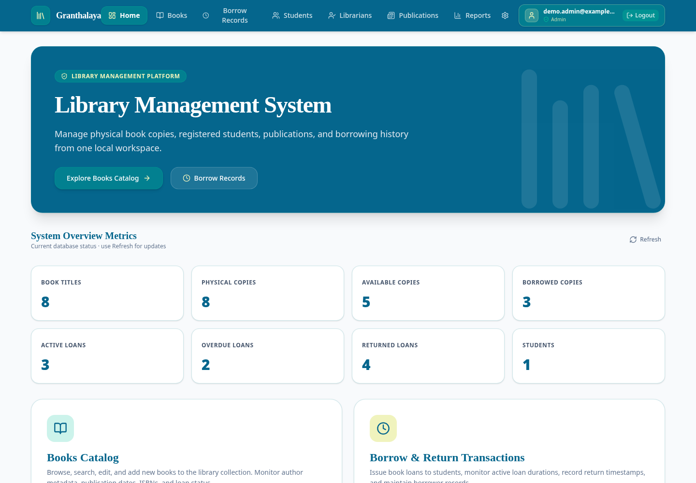
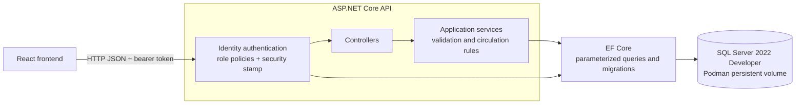
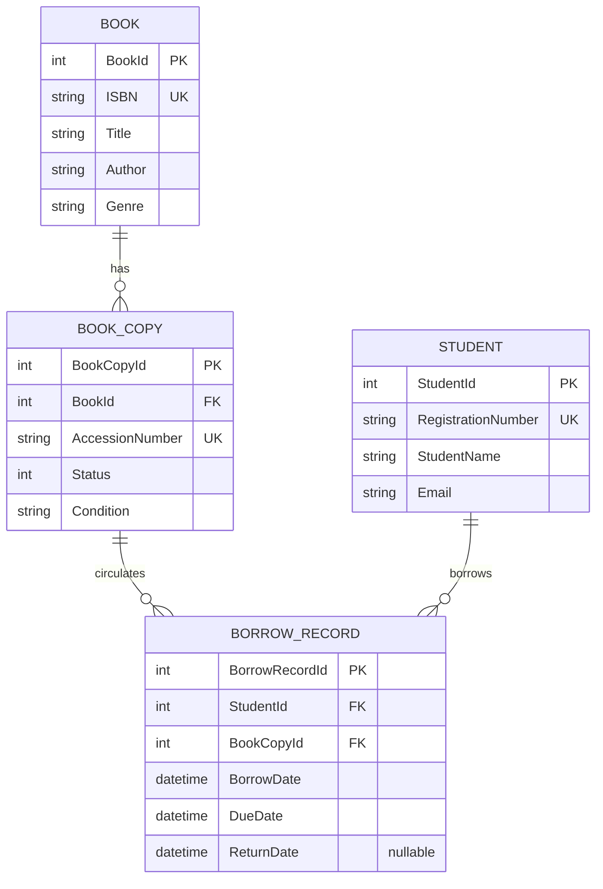
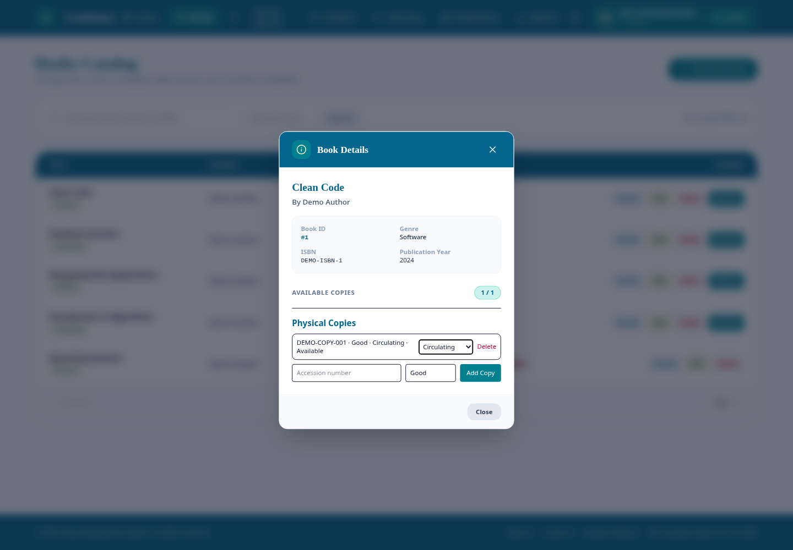
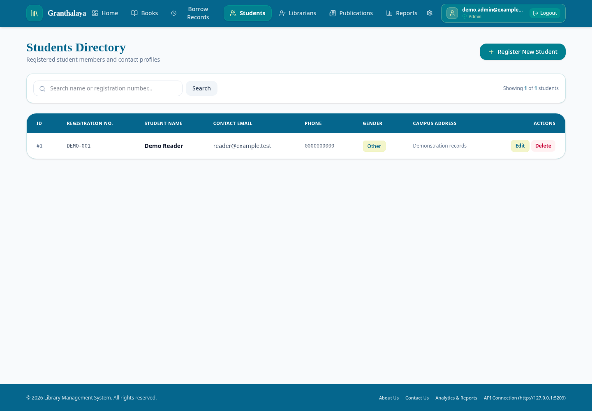
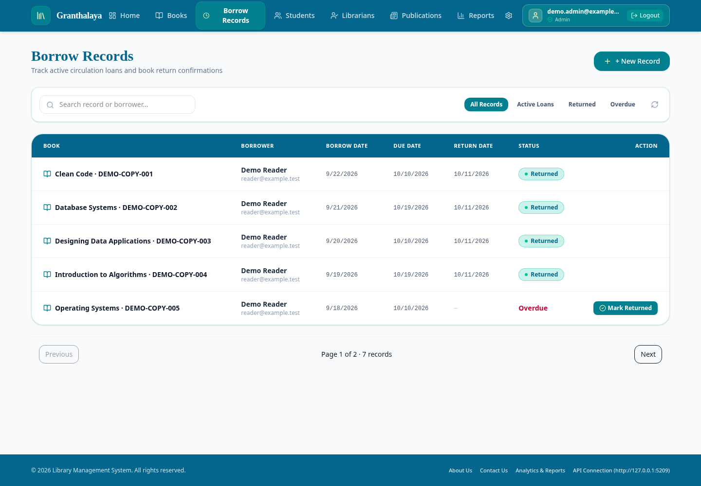
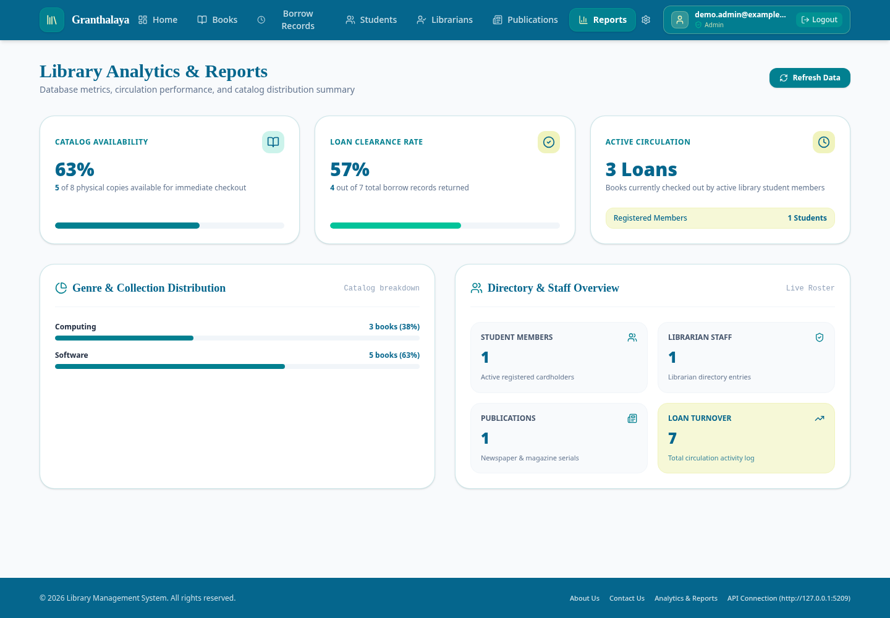
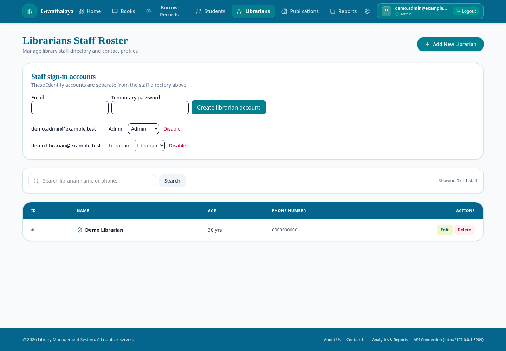

# Granthalaya v2

A local-only, full-stack library-management application built with ASP.NET Core 10, React 19, and SQL Server 2022 Developer. Granthalaya manages book titles and individual physical copies, registered student borrowers, circulation history, publications, and staff access through Admin/Librarian roles.

The application runs on your Linux machine. There is no hosted demo or cloud deployment component.



## Features

- Search and edit the book catalog by title, author, ISBN, or genre.
- Track physical copies by unique accession number, condition, and circulation status.
- Register and edit students with unique registration numbers and validated email addresses.
- Issue available copies, require due dates, record returns, and preserve borrowing history.
- Search and paginate all, active, returned, and overdue loans on the server.
- View database-derived inventory, circulation metrics, recent borrowing, and genre distribution.
- Use Admin/Librarian role-based access with explicit administrator bootstrap and Admin-managed staff accounts.
- Manage newspaper/magazine publications and calendar issue dates.
- Submit local contact inquiries; Admins can search and paginate the inbox. No email is sent.

## Stack and structure

| Layer | Technology |
|---|---|
| Frontend | React 19, TypeScript, Vite, Tailwind CSS, existing Motion/Lucide components |
| Backend | ASP.NET Core 10 controllers, application services, Problem Details |
| Persistence | EF Core 10 migrations, SQL Server 2022 Developer |
| Authentication | ASP.NET Core Identity opaque bearer tokens and security-stamp validation |
| Development | Rootless Podman with a Compose provider, npm, pinned local `dotnet-ef` tool |
| Verification | xUnit, SQL Server integration tests, five Playwright browser journeys |

```text
Library-Management-System/        API, services, domain, Identity, migrations
Library-Management-System.Tests/ Backend and SQL Server integration tests
LMS-Frontend/src/                React application
LMS-Frontend/e2e/                Playwright journeys
dev/                            Compose and isolated E2E runner
docs/                           Setup, security review, verification, screenshots
DEMO.md                         Screen-recording walkthrough and resume options
```

## Architecture



Business rules are enforced by services and relational constraints. The frontend displays persisted results and refreshes affected records after mutations. It does not decide copy availability by maintaining independent inventory statistics.

## Database design



A **Book** stores title metadata; a **BookCopy** represents an accession-numbered physical item. Availability requires `Circulating` physical status and no active loan. The filtered unique index `UX_BorrowRecords_ActiveCopy`, where `ReturnDate IS NULL`, prevents two active loans for one copy, including concurrent requests. ISBN, accession number, and student registration number are unique.

Returns update the loan rather than deleting it. Student, copy, and title deletion is rejected when borrowing history exists. Foreign keys use restricted deletion; date constraints require a due date after borrowing and a return no earlier than borrowing. Pagination uses stable date/ID sorting, bounded page sizes, and supporting history/inquiry indexes.

Identity staff accounts, the librarian directory, publications, and contact inquiries are separate records. A librarian directory entry does not create a sign-in account.

## Authentication and roles

| Operation | Admin | Librarian | Anonymous |
|---|---:|---:|---:|
| Catalog, copies, students, circulation | Yes | Yes | No |
| Publications, dashboard, reports | Yes | Yes | No |
| Librarian directory and staff accounts | Yes | No | No |
| Promote/demote or disable/enable staff | Yes | No | No |
| Read contact inquiries | Yes | No | No |
| Submit a contact inquiry | Yes | Yes | Yes |
| Staff login | Credentials required | Credentials required | Login endpoint only |

Students are borrower records, not authenticated users. Initial Admin provisioning is an explicit CLI command; public staff registration is unavailable. The last active Admin cannot be demoted or disabled.

Identity issues **opaque bearer tokens, not JWTs**. The frontend stores only the access token in `sessionStorage`, validates the session after refresh, and uses the normal 30-minute lifetime. Logout, password changes, role changes, and account disable revoke existing tokens through security-stamp/lockout checks on every request. Tokens in JavaScript storage remain vulnerable to XSS and malicious browser extensions; see [the security review](docs/SECURITY.md).

## Run locally

Prerequisites: Linux x64, .NET 10 SDK, Node.js 22 or newer, npm, Podman, a Compose provider, and a supported Chromium browser for E2E testing. SQL Server data stays in the named Podman volume during normal stops/restarts.

Follow [the complete Bash and Fish setup guide](docs/LOCAL_SETUP.md) for cloning, dependency installation, private SQL credentials, migrations, Admin bootstrap, startup, testing, and safe restart. No script resets the persistent development database.

After initial setup, use separate terminals:

```bash
# Repository root
podman compose --env-file dev/sqlserver.env -f dev/compose.yaml up -d
# API terminal
dotnet run --project Library-Management-System
# Frontend terminal
npm --prefix LMS-Frontend run dev
```

Open `http://127.0.0.1:3000`; the API uses `http://localhost:5199`. API connection settings accept loopback URLs only. Swagger is available in Development at `/swagger`.

## Actual application screenshots

Captured from the running React application and real SQL Server API at **1440 × 1000**, using neutral disposable demonstration records. No real user records or credentials are shown.

| Catalog and physical copies | Students |
|---|---|
|  |  |

| Borrowing and returns | Reports |
|---|---|
|  |  |



## Testing

The final observed backend run passed **39 tests, 0 failed, 0 skipped**. Seven test cases require real SQL Server; they migrate and delete only uniquely named disposable databases. Other tests check service validation, controllers, authorization, and authentication. In-memory tests are not a substitute for relational validation.

The five Playwright journeys exercise:

1. Admin catalog/copies, genre filtering, publications/date editing, and librarian directory CRUD.
2. Student registration, borrowing, returning, inventory, and filtered history pagination.
3. Librarian visibility, direct forbidden API requests, refresh initialization, invalid tokens, and logout revocation.
4. Native form validation, duplicate identifiers, borrowing conflicts, and the Admin inquiry inbox.
5. Staff account creation, role changes, disable/re-enable, token revocation, and password changes.

```bash
# Set the private test-server environment as described in LOCAL_SETUP.md first.
dotnet test Library-Management-System.Tests
npm --prefix LMS-Frontend run test:e2e
```

The E2E runner generates account credentials in memory, creates `Granthalaya_E2E_<random>` with neutral data, starts loopback-only API/frontend processes, and removes that generated database in cleanup. Missing SQL configuration fails the runner. Traces/screenshots on failure remain in ignored `artifacts/e2e/` and may contain temporary test credentials; do not publish them. Use `-- --screenshots` to refresh only the curated portfolio captures.

See [verification results](docs/VERIFICATION.md) and [DEMO.md](DEMO.md) for the walkthrough script and resume bullet options.

## Known limitations

- Local-only application with no hosted live demo; SQL Server is required.
- No public student self-registration, reservations, renewals, fines, payments, or automatic email delivery.
- Title/student/directory tables retain their existing UI structure; this batch does not redesign the application.
- Search uses SQL Server text matching rather than full-text indexing.
- Setup was executed on the current Linux host; distribution package installation on a fresh machine was not performed.
- Historical credentials remain in Git history and require rotation wherever used. Current-source cleanup does not remove historical exposure.

## Future improvements

Broader browser/assistive-technology coverage, database backup/restore documentation, and measured query tuning for larger local catalogs are realistic next steps.

## License

No project-level `LICENSE` file is present. Third-party bundled assets have their own license notices; they do not establish a license for Granthalaya. The repository owner must choose a project license.
