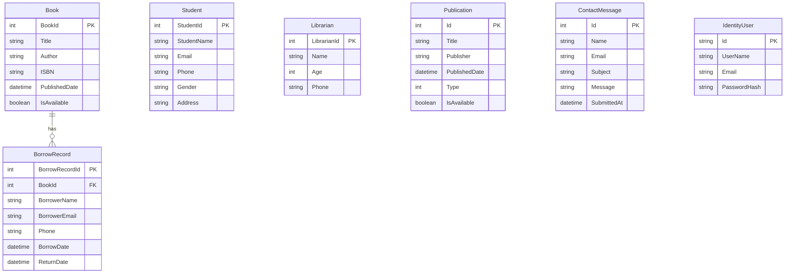
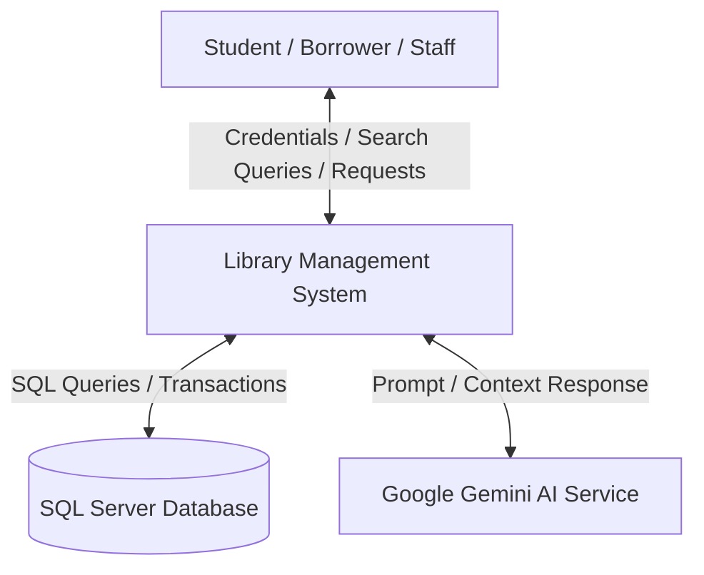
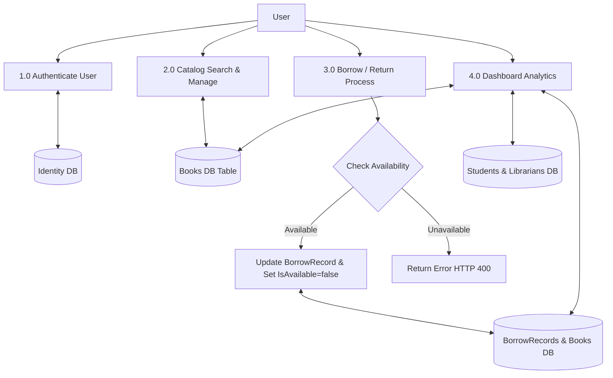
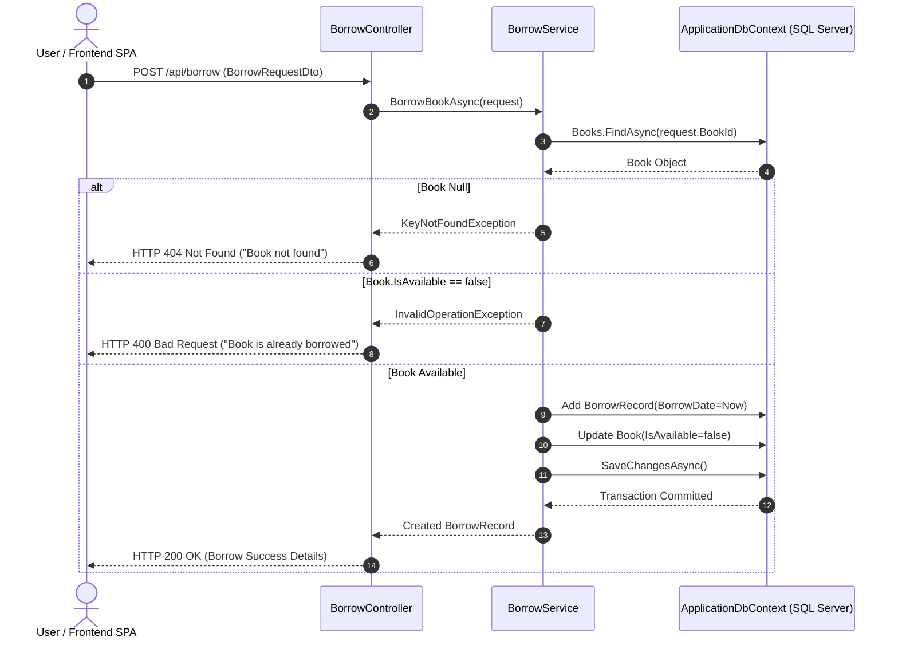

> Historical pre-v2 design document. It includes superseded architecture and aspirational features. Use the root README and current docs for implemented behavior and setup.

# Software Requirements Specification (SRS) & System Design Description (SDD)
## Library Management System (LMS)

**Document Standard:** IEEE Std 830-1998 & IEEE Std 1016-2009  
**Document Version:** 1.0.0  
**Date:** July 30, 2026  
**Author / Development Team:** Software Engineering Team  
**Status:** Approved  
**Target Repository:** `/home/daksh/Projects/LMS`  

---

## Executive Summary & Document Control

| Parameter | Specification |
| :--- | :--- |
| **System Name** | Library Management System (LMS) |
| **System Type** | Web-based N-Tier Enterprise Software Application |
| **Backend Stack** | ASP.NET Core 10.0 Web API, Entity Framework Core 10, ASP.NET Core Identity |
| **Database Engine** | Microsoft SQL Server (Containerized / Relational Engine) |
| **Frontend Stack** | React 19, TypeScript 5.8, Vite 6, TailwindCSS v4, Framer Motion |
| **Artificial Intelligence** | Google GenAI (Gemini API SDK Integration) |
| **Test Automation** | xUnit, Moq, EF Core InMemory |
| **Security Standard** | OAuth2 / Bearer JWT Authentication, Password Hashing, CORS Controls |

---

# Table of Contents
1. [Section 1: Introduction](#1-introduction)
   - 1.1 Purpose
   - 1.2 Scope
   - 1.3 Definitions, Acronyms, and Abbreviations
   - 1.4 References
   - 1.5 Document Overview
2. [Section 2: Overall Description](#2-overall-description)
   - 2.1 Product Perspective
   - 2.2 Product Functions Overview
   - 2.3 User Classes and Characteristics
   - 2.4 Operating Environment
   - 2.5 Design and Implementation Constraints
   - 2.6 Assumptions and Dependencies
3. [Section 3: System Features and Functional Requirements](#3-system-features-and-functional-requirements)
   - 3.1 Authentication & Authorization Module (`/api/auth`)
   - 3.2 Book Inventory Management Module (`/api/books`)
   - 3.3 Circulation & Borrowing Operations Module (`/api/borrow`)
   - 3.4 Student / Borrower Management Module (`/api/students`)
   - 3.5 Staff / Librarian Management Module (`/api/librarians`)
   - 3.6 Periodicals & Publication Module (`/api/publications`)
   - 3.7 Analytics & Dashboard Reporting Module (`/api/dashboard`)
   - 3.8 Support & Inquiry Contact Module (`/api/contact`)
   - 3.9 AI Assistance Module (Google GenAI Integration)
4. [Section 4: External Interface Requirements](#4-external-interface-requirements)
   - 4.1 User Interfaces (UI Layout & Navigation)
   - 4.2 Hardware Interfaces
   - 4.3 Software Interfaces
   - 4.4 Communication Interfaces
5. [Section 5: System Architecture & Data Design (IEEE 1016)](#5-system-architecture--data-design-ieee-1016)
   - 5.1 N-Tier Architectural Pattern
   - 5.2 Database Entity-Relationship Diagram (ERD)
   - 5.3 Data Flow Diagrams (DFD Level 0 & Level 1)
   - 5.4 UML Sequence Diagrams
6. [Section 6: Non-Functional Requirements & Quality Attributes](#6-non-functional-requirements--quality-attributes)
   - 6.1 Performance Requirements
   - 6.2 Security & Data Protection
   - 6.3 Reliability & Availability
   - 6.4 Maintainability & Extensibility
   - 6.5 Usability & Accessibility
7. [Section 7: Verification & Testing Strategy](#7-verification--testing-strategy)
   - 7.1 Unit Testing Framework
   - 7.2 Service Test Cases Breakdown
8. [Section 8: Deployment & Execution Manual](#8-deployment--execution-manual)
   - 8.1 System Prerequisites
   - 8.2 Database Migration Setup
   - 8.3 Backend API Deployment
   - 8.4 Frontend SPA Deployment
9. [Section 9: Appendix](#9-appendix)

---

<a id="1-introduction"></a>
# 1. Introduction

## 1.1 Purpose
This document provides a comprehensive **Software Requirements Specification (SRS)** adhering to **IEEE Std 830-1998** and a **System Design Description (SDD)** adhering to **IEEE Std 1016-2009** for the **Library Management System (LMS)**. It describes the complete functional requirements, architectural breakdown, data model, external interfaces, security constraints, non-functional quality attributes, and verification suites.

## 1.2 Scope
The Library Management System (LMS) is a modernized enterprise web platform designed to streamline library circulation, inventory control, member tracking, staff administration, periodical management, and analytics reporting.

**Core System Boundaries:**
- **Catalog Management:** Full CRUD operations on physical books with pagination, title/author/ISBN search, and availability tracking.
- **Circulation Management:** Checkout (borrowing) and return tracking with automated stock status modification and date auditing.
- **Member Management:** Registration and management of registered Students and Librarians.
- **Periodicals Management:** Tracking of Magazines and Newspapers (`PublicationType`).
- **Real-Time Analytics:** Metric aggregation for dashboard visualization (total inventory, active borrows, overdue items, member counts).
- **Interactive AI Support:** Integrated Gemini AI Assistant for smart catalog recommendations and natural language query assistance.
- **User Authentication:** Token-based API access control powered by ASP.NET Core Identity.

## 1.3 Definitions, Acronyms, and Abbreviations

| Abbreviation / Term | Definition |
| :--- | :--- |
| **API** | Application Programming Interface |
| **CORS** | Cross-Origin Resource Sharing |
| **DFD** | Data Flow Diagram |
| **DTO** | Data Transfer Object |
| **EF Core** | Entity Framework Core (Object-Relational Mapper for .NET) |
| **ERD** | Entity-Relationship Diagram |
| **IEEE** | Institute of Electrical and Electronics Engineers |
| **JWT** | JSON Web Token |
| **LMS** | Library Management System |
| **ORM** | Object-Relational Mapping |
| **REST** | Representational State Transfer |
| **SDD** | Software Design Description (IEEE Std 1016) |
| **SPA** | Single Page Application |
| **SRS** | Software Requirements Specification (IEEE Std 830) |
| **UI/UX** | User Interface / User Experience |

## 1.4 References
1. IEEE Computer Society, *IEEE Std 830-1998: IEEE Recommended Practice for Software Requirements Specifications*, IEEE, 1998.
2. IEEE Computer Society, *IEEE Std 1016-2009: IEEE Standard for Information Technology—Systems Design—Software Design Descriptions*, IEEE, 2009.
3. Microsoft .NET 10.0 & Entity Framework Core Documentation.
4. React 19 & Vite 6 Developer Guides.

## 1.5 Document Overview
The remainder of this document details the overall application perspective (Section 2), specific functional requirements per endpoint (Section 3), interface requirements (Section 4), system architecture and database design diagrams (Section 5), non-functional quality vectors (Section 6), automated verification strategy (Section 7), deployment steps (Section 8), and appendices (Section 9).

---

<a id="2-overall-description"></a>
# 2. Overall Description

## 2.1 Product Perspective
The LMS software is built on an **N-Tier Client-Server Architecture** decoupling the client user experience from the core business logic and persistence engine.

```
+-------------------------------------------------------------------+
|                        REACT 19 SPA FRONTEND                      |
| (Vite 6, TypeScript, TailwindCSS v4, Lucide React, Framer Motion) |
+-------------------------------------------------------------------+
                                 |  HTTP / REST (JSON)
                                 v
+-------------------------------------------------------------------+
|                   ASP.NET CORE 10 WEB API BACKEND                 |
| (Controllers -> DTO Mappers -> Service Layer -> Identity Endpoints)|
+-------------------------------------------------------------------+
                                 |  Entity Framework Core 10
                                 v
+-------------------------------------------------------------------+
|                     MICROSOFT SQL SERVER DATABASE                 |
|       (Tables: Books, BorrowRecords, Students, Librarians, etc.)  |
+-------------------------------------------------------------------+
```

## 2.2 Product Functions Overview
- **Book Catalog Administration:** Search, add, edit, soft-check, and delete books.
- **Circulation & Checkout:** Process borrowing transactions, validate book availability, prevent duplicate checkouts, and handle returns.
- **Student & Staff Portals:** Maintain student directory records (Email, Phone, Address, Gender) and Librarian profiles.
- **Publications Management:** Separate tracking for daily newspapers and periodical magazines with availability status.
- **Dashboard Reporting:** Calculate total books, active borrows, overdue borrows, student membership count, librarian count, and publication volume.
- **Contact & Inquiry System:** Submit and view administrative support messages.
- **AI-Powered Library Assistant:** Generative AI sidebar interface powered by Google GenAI (`@google/genai`).

## 2.3 User Classes and Characteristics

| User Class | Privileges & Responsibilities | Technical Proficiency |
| :--- | :--- | :--- |
| **System Administrator** | Full administrative rights over books, students, librarians, publications, system metrics, and configuration. | High |
| **Librarian / Staff** | Manages catalog items, issues/returns books, registers students, and reviews borrowing logs. | Medium |
| **Student / Borrower** | Browses available titles, views personal borrowing history, sends support inquiries. | Low to Medium |
| **Guest / Visitor** | Views public catalog, landing pages, and contact forms. | Low |

## 2.4 Operating Environment
- **Server Operating System:** Linux (Ubuntu 22.04 LTS / Debian 12 / Enterprise Linux) or Windows Server 2022.
- **Backend Runtime Environment:** .NET 10.0 Web SDK (`net10.0`).
- **Database Engine:** Microsoft SQL Server 2019 / 2022 / Dockerized SQL Server Container (`LMSSQLServerData`).
- **Frontend Web Server:** Node.js v20+ / Vite Dev Server (Port 3000) or Nginx / Kestrel reverse proxy.
- **Client Browsers:** Google Chrome v110+, Mozilla Firefox v110+, Apple Safari v16+, Microsoft Edge v110+.

## 2.5 Design and Implementation Constraints
1. **Framework Constraints:** Backend built strictly in C# .NET 10 Web API; Frontend built strictly in React 19 + TypeScript.
2. **Persistence Constraints:** Must utilize Entity Framework Core 10 ORM with Code-First Migrations (`ApplicationDbContext`).
3. **API Standards:** RESTful principles with JSON request/response bodies and explicit DTO validation models.
4. **Security Constraints:** Sensitive endpoints protected via ASP.NET Core Identity API Endpoints (`/api/auth`).
5. **CORS Policy:** Whitelisted to authorized frontend origins (`http://localhost:3000`, `http://localhost:5173`, `http://localhost:8080`).

## 2.6 Assumptions and Dependencies
- Connection string `DefaultConnection` points to an accessible Microsoft SQL Server instance.
- The system depends on `@google/genai` npm package for AI-driven assistant features (requires API key set in frontend `.env`).

---

<a id="3-system-features-and-functional-requirements"></a>
# 3. System Features and Functional Requirements

## 3.1 Authentication & Authorization Module (`/api/auth`)

### 3.1.1 Overview
Provides secure user authentication, registration, login, and bearer token generation utilizing ASP.NET Core Identity Endpoints.

### 3.1.2 Functional Requirements

| ID | Feature | Endpoint | Method | Input Body | Success Output |
| :--- | :--- | :--- | :--- | :--- | :--- |
| **FR-AUTH-01** | User Registration | `/api/auth/register` | `POST` | `{ email, password }` | HTTP 200 OK |
| **FR-AUTH-02** | User Login | `/api/auth/login` | `POST` | `{ email, password }` | HTTP 200 OK + JWT Access/Refresh Token |
| **FR-AUTH-03** | Token Refresh | `/api/auth/refresh` | `POST` | `{ refreshToken }` | HTTP 200 OK + New JWT Token |

---

## 3.2 Book Inventory Management Module (`/api/books`)

### 3.2.1 Overview
Handles the creation, retrieval, searching, updating, and deletion of catalog books via `IBookService`.

### 3.2.2 Data Contract (`Book` Model)
- `BookId` (int, Primary Key, Auto-increment)
- `Title` (string, Required)
- `Author` (string, Required)
- `ISBN` (string, Required)
- `PublishedDate` (DateTime)
- `IsAvailable` (bool, Default: `true`)

### 3.2.3 Functional Requirements

```
+--------------------------------------------------------------------------+
| REQ ID      | METHOD | ENDPOINT               | DESCRIPTION              |
+--------------------------------------------------------------------------+
| FR-BOOK-01  | GET    | /api/books             | Get paginated books with |
|             |        |                        | optional search query    |
| FR-BOOK-02  | GET    | /api/books/{id}        | Fetch book by ID         |
| FR-BOOK-03  | POST   | /api/books             | Add new book to catalog  |
| FR-BOOK-04  | PUT    | /api/books/{id}        | Update book metadata     |
| FR-BOOK-05  | DELETE | /api/books/{id}        | Remove book from catalog |
+--------------------------------------------------------------------------+
```

---

## 3.3 Circulation & Borrowing Operations Module (`/api/borrow`)

### 3.3.1 Overview
Manages book checkouts and returns, updating book availability status atomically via `IBorrowService`.

### 3.3.2 Functional Requirements & Logic

1. **Borrow Book (`POST /api/borrow`)**
   - **Input:** `BorrowRequestDto` (`{ bookId, borrowerName, borrowerEmail, phone }`)
   - **Validation:** Checks if `BookId` exists. If not, throws `KeyNotFoundException` (HTTP 404).
   - **Availability Check:** Verifies `Book.IsAvailable == true`. If unavailable, throws `InvalidOperationException` (HTTP 400).
   - **Processing:** Creates `BorrowRecord` with `BorrowDate = DateTime.UtcNow`, sets `Book.IsAvailable = false`.
   - **Output:** `{ message, borrowRecordId, borrowDate }`

2. **Return Book (`POST /api/borrow/return/{borrowRecordId}`)**
   - **Input:** `borrowRecordId` (path parameter)
   - **Validation:** Fetches `BorrowRecord`. If not found, returns HTTP 404.
   - **Return Processing:** Sets `ReturnDate = DateTime.UtcNow`, sets referenced `Book.IsAvailable = true`.
   - **Output:** `{ message, bookTitle, returnDate }`

3. **Get Borrow Records (`GET /api/borrow/records`)**
   - **Output:** Returns complete list of `BorrowRecord` objects including nested `Book` details.

---

## 3.4 Student / Borrower Management Module (`/api/students`)

### 3.4.1 Overview
Maintains records of enrolled students eligible for library privileges (`StudentsController`).

### 3.4.2 Schema Attributes
- `StudentId` (int, PK)
- `StudentName` (string)
- `Email` (string)
- `Phone` (string)
- `Gender` (string)
- `Address` (string)

---

## 3.5 Staff / Librarian Management Module (`/api/librarians`)

### 3.5.1 Overview
Manages library staff personnel data (`LibrariansController`).

### 3.5.2 Schema Attributes
- `LibrarianId` (int, PK)
- `Name` (string)
- `Age` (int)
- `Phone` (string)

---

## 3.6 Periodicals & Publication Module (`/api/publications`)

### 3.6.1 Overview
Tracks physical periodicals, journals, and newspapers (`PublicationsController`).

### 3.6.2 Schema & Classification
- `Id` (int, PK)
- `Title` (string)
- `Publisher` (string)
- `PublishedDate` (DateTime)
- `Type` (`PublicationType` Enum: `0 = Newspaper`, `1 = Magazine`)
- `IsAvailable` (bool)

---

## 3.7 Analytics & Dashboard Reporting Module (`/api/dashboard`)

### 3.7.1 Overview
Provides calculated operational metrics for the administrative overview panel via `IDashboardService`.

### 3.7.2 Calculated Metrics (`DashboardMetricsDto`)
- `TotalBooks` (int): Total count of records in `Books` table.
- `TotalStudents` (int): Total count of records in `Students` table.
- `ActiveBorrows` (int): Count of `BorrowRecord` entries where `ReturnDate == null`.
- `OverdueBorrows` (int): Count of `BorrowRecord` entries where `ReturnDate == null` and `BorrowDate` exceeds maximum rental policy allowance.
- `TotalPublications` (int): Total count of records in `Publications` table.
- `TotalLibrarians` (int): Total count of records in `Librarians` table.

---

## 3.8 Support & Inquiry Contact Module (`/api/contact`)

### 3.8.1 Overview
Enables users to send inquiries directly to library administrators (`ContactController`).

### 3.8.2 Schema Attributes
- `Id` (int, PK)
- `Name` (string, Required)
- `Email` (string, Required, Valid Email format)
- `Subject` (string)
- `Message` (string, Required)
- `SubmittedAt` (DateTime, Default: `UtcNow`)

---

## 3.9 AI Assistance Module (Google GenAI Integration)

### 3.9.1 Overview
Integrates Google Gemini model via `@google/genai` in the frontend client. Users can ask questions regarding available catalog topics, library rules, author recommendations, or book summaries.

---

<a id="4-external-interface-requirements"></a>
# 4. External Interface Requirements

## 4.1 User Interfaces (UI Layout & Navigation)
The client frontend is designed as a responsive Single-Page Application (SPA):
- **Global Navigation bar:** System logo, page view switchers (`Dashboard`, `Books`, `Borrow Records`, `Students`, `Librarians`, `Publications`, `Reports`, `Contact`, `About`), Theme Mode Toggle, Login/User Profile Modal button.
- **Dynamic Views:**
  - `DashboardView`: Key Performance Indicator (KPI) metric cards, quick action buttons, live stats.
  - `BooksView`: Search bar, filter dropdowns, table/grid layout with Availability badges, Add/Edit/Delete modals.
  - `BorrowRecordsView`: Active borrow log, return modal, overdue tags.
  - `StudentsView` & `LibrariansView`: Directory management tables with edit/delete triggers.
  - `PublicationsView`: Categorized view for Newspapers vs. Magazines.
  - `ContactView`: Interactive contact form with input validation and feedback toast notifications.
- **Feedback & Dialog Systems:**
  - `Toast.tsx`: Dynamic notification popups (Success, Error, Warning, Info).
  - `ConfirmModal.tsx`: Destructive action confirmation wrapper.
  - `LoginModal.tsx`: Identity authentication popup.

## 4.2 Hardware Interfaces
- No direct physical hardware interfaces are required. Standard network cards and HTTP-compliant storage devices apply.

## 4.3 Software Interfaces
- **Database Server:** Microsoft SQL Server connection over TCP/IP port 1433 via `Microsoft.EntityFrameworkCore.SqlServer`.
- **Swagger / OpenAPI:** API documentation and interactive endpoint testing exposed via `Swashbuckle.AspNetCore` at `/swagger`.

## 4.4 Communication Interfaces
- **Protocol:** HTTP/1.1 and HTTP/2 over TLS (HTTPS).
- **Data Exchange Format:** `application/json`.
- **CORS Configuration:** ASP.NET Core policy `AllowFrontend` configured for cross-origin communications.

---

<a id="5-system-architecture--data-design-ieee-1016"></a>
# 5. System Architecture & Data Design (IEEE 1016)

## 5.1 N-Tier Architectural Pattern

```
+-------------------------------------------------------------------+
|                        PRESENTATION TIER                          |
|             React 19 SPA + TypeScript + Vite + Tailwind           |
+-------------------------------------------------------------------+
                                 |  JSON HTTP Calls
                                 v
+-------------------------------------------------------------------+
|                        APPLICATION API TIER                       |
|           ASP.NET Core 10 Controllers & Middleware Pipeline       |
+-------------------------------------------------------------------+
                                 |  Dependency Injection
                                 v
+-------------------------------------------------------------------+
|                          BUSINESS TIER                            |
|       Services: BookService, BorrowService, DashboardService       |
+-------------------------------------------------------------------+
                                 |  EF Core 10 Linq Queries
                                 v
+-------------------------------------------------------------------+
|                       DATA PERSISTENCE TIER                       |
|    ApplicationDbContext <-> SQL Server Relational Storage Engine   |
+-------------------------------------------------------------------+
```

---

## 5.2 Database Entity-Relationship Diagram (ERD)



---

## 5.3 Data Flow Diagrams (DFD)

### 5.3.1 DFD Level 0 (System Context Diagram)



### 5.3.2 DFD Level 1 (Process Decomposition Diagram)



---

## 5.4 UML Sequence Diagrams

### 5.4.1 Sequence Diagram: Book Checkout (Borrow) Workflow



---

<a id="6-non-functional-requirements--quality-attributes"></a>
# 6. Non-Functional Requirements & Quality Attributes

## 6.1 Performance Requirements
- **API Response Time:** 95% of read requests (`GET /api/books`, `GET /api/dashboard/metrics`) shall respond in under 150ms.
- **Database Query Efficiency:** Paginated catalog retrieval (`GetPaginatedBooksAsync`) limits payload sizes to avoid memory overhead.
- **Client Rendering:** Client UI initial bundle load under 2 seconds on broadband connections; UI updates powered by Vite fast refresh and lightweight DOM diffing.

## 6.2 Security & Data Protection
- **Authentication & Authorization:** Secure ASP.NET Core Identity implementation mapped under `/api/auth`.
- **Token Security:** Bearer JWT tokens with customizable expiration policies.
- **SQL Injection Prevention:** All database operations utilize Entity Framework Core parameterized LINQ queries, eliminating standard SQL injection vulnerabilities.
- **Cross-Site Scripting (XSS):** React automatically escapes rendered strings in JSX.
- **CORS Safeguards:** Strict origin matching ensures unauthorized external domains cannot invoke API routes.

## 6.3 Reliability & Availability
- **Transactional Integrity:** Operations involving multiple updates (e.g., creating a `BorrowRecord` and setting `Book.IsAvailable = false`) execute atomically within EF Core database transactions.
- **Exception Handling Middleware:** Built-in exception handler pipeline (`app.UseExceptionHandler`) catches unexpected server errors cleanly without leaking stack trace info in non-development modes.

## 6.4 Maintainability & Extensibility
- **Loose Coupling:** Clean separation between Controller API endpoints, Service interface logic (`IBookService`, `IBorrowService`, `IDashboardService`), and Entity ORM definitions.
- **Dependency Injection:** Services registered as scoped dependencies in `Program.cs`.

## 6.5 Usability & Accessibility
- **Modern UI Aesthetic:** Styled using TailwindCSS v4 with harmonious color schemes, smooth CSS transitions, and modal dialogs.
- **Intuitive Feedback:** Toast notification system provides clear visual feedback for all success and error actions.

---

<a id="7-verification--testing-strategy"></a>
# 7. Verification & Testing Strategy

## 7.1 Unit Testing Framework
The automated test project `Library-Management-System.Tests` uses **xUnit**, **Moq**, and **EF Core InMemory** to validate business logic in isolation.

```
+------------------------------------------------------------------+
| TEST SUITE                           | TARGET COMPONENT          |
+------------------------------------------------------------------+
| BookServiceTests.cs                  | BookService.cs            |
| BorrowServiceTests.cs                | BorrowService.cs          |
| DashboardServiceTests.cs             | DashboardService.cs       |
+------------------------------------------------------------------+
```

## 7.2 Service Test Cases Breakdown

### 7.2.1 `BookServiceTests.cs`
1. `GetPaginatedBooksAsync_ShouldReturnCorrectPageSizeAndTotalCount`
2. `CreateBookAsync_ShouldAddBookToDatabase`
3. `DeleteBookAsync_ShouldReturnNull_WhenBookDoesNotExist`

### 7.2.2 `BorrowServiceTests.cs`
1. `BorrowBookAsync_ShouldCreateRecordAndSetBookUnavailable_WhenBookIsAvailable`
2. `BorrowBookAsync_ShouldThrowInvalidOperationException_WhenBookIsAlreadyBorrowed`
3. `ReturnBookAsync_ShouldSetReturnDateAndMakeBookAvailable`

### 7.2.3 `DashboardServiceTests.cs`
1. `GetMetricsAsync_ShouldReturnAccurateCountsForBooksBorrowsAndStudents`

---

<a id="8-deployment--execution-manual"></a>
# 8. Deployment & Execution Manual

## 8.1 System Prerequisites
- **.NET SDK:** Version 10.0 or higher.
- **Node.js:** Version 20.0 or higher (with `npm`).
- **SQL Server:** SQL Server 2019+ or Docker Engine.

## 8.2 Database Migration Setup
```bash
# Navigate to backend directory
cd Library-Management-System

# Update Connection String in appsettings.json if necessary, then run EF Core migrations:
dotnet ef database update
```

## 8.3 Backend API Deployment
```bash
# Restore dependencies and build project
dotnet build

# Execute backend web server
dotnet run
# API will start listening on https://localhost:7123 / http://localhost:5084
# Swagger UI available at: http://localhost:5084/swagger
```

## 8.4 Frontend SPA Deployment
```bash
# Navigate to frontend directory
cd LMS-Frontend

# Install NPM packages
npm install

# Run development server
npm run dev
# Single Page Application will be served at http://localhost:3000
```

---

<a id="9-appendix"></a>
# 9. Appendix

## 9.1 Configuration Files Reference

### `appsettings.json` (Backend Connection String)
```json
{
  "ConnectionStrings": {
    "DefaultConnection": "Server=localhost;Database=LMS_Db;Trusted_Connection=True;MultipleActiveResultSets=true;TrustServerCertificate=True"
  },
  "Logging": {
    "LogLevel": {
      "Default": "Information",
      "Microsoft.AspNetCore": "Warning"
    }
  },
  "AllowedHosts": "*"
}
```

### `package.json` (Frontend Scripts & Dependencies)
- `scripts.dev`: `vite --port=3000 --host=0.0.0.0`
- `dependencies`: `@google/genai`, `react`, `react-dom`, `lucide-react`, `motion`, `tailwindcss`

---
**End of IEEE Software Requirements Specification & Design Document**
